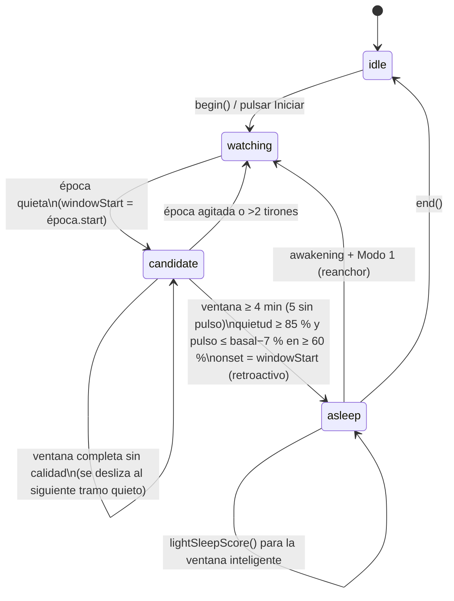

# Somni — Arquitectura

App nativa para iPhone + Apple Watch de alarmas adaptativas: la siesta cuenta desde que te duermes de verdad (Modo 1) y el despertar por ciclos suena al final del último ciclo completo antes de tu hora límite (Modo 2).

## 1. Diseño modular

```
Somni/
├── Packages/SomniKit/            SPM compartido (iOS 18+, watchOS 11+, macOS para tests)
│   ├── Models/                   SleepMode, CycleModel, SleepSessionConfig, SensorEpoch, MotionEpochAggregator
│   ├── Engine/                   RingBuffer, SleepStateBuffer, SleepEngine (máquina de estados pura)
│   ├── Alarm/                    AlarmPlanner (cálculo puro de Modo 1 / Modo 2 / fail-safe / estrategia de runtime)
│   └── Sync/                     SessionSnapshot, SomniSettings, SleepSessionRecord, SyncCommand, ConnectivityBridge
├── Apps/SomniWatch/              Nodo de captura y de alarma
│   ├── Services/                 SleepDetectionService (HealthKit + CoreMotion), AlarmManager (disparo + redundancia)
│   ├── ViewModels/               WatchSessionViewModel (orquestador, dueño del SleepEngine)
│   └── Views/                    WatchContentView
└── Apps/SomniPhone/              Configuración, analítica, mando a distancia y alarma de respaldo (AlarmKit)
```

Reglas de dependencia (Clean Architecture):

| Capa | Contiene | Depende de |
|---|---|---|
| Dominio (`SomniKit`) | Modelos, `SleepEngine`, `AlarmPlanner` | Solo Foundation. Sin relojes, sensores ni hilos: todo es determinista y se prueba en el Mac (`swift test`). |
| Infraestructura (apps) | `SleepDetectionService`, `AlarmManager`, `BackupAlarmScheduler`, `ConnectivityBridge` | Frameworks de Apple y el dominio |
| Presentación (MVVM) | `WatchSessionViewModel`, `PhoneSessionStore`, vistas SwiftUI | Combine (`@Published`, `PassthroughSubject`) + `async/await` |

El motor y el planificador son tipos valor puros. El view model es el único que muta el `SleepEngine` y lo hace en `@MainActor`, así que no hacen falta locks.

## 2. Ciclo de vida en segundo plano en watchOS

### Qué mantiene vivo el proceso

| Mecanismo | Qué aporta | Límites |
|---|---|---|
| `HKWorkoutSession` (`.mindAndBody`) + `HKLiveWorkoutBuilder` | El proceso sigue ejecutándose con la muñeca bajada. Pulso en modo entrenamiento (en la práctica cada pocos segundos; Apple no garantiza la frecuencia exacta). CoreMotion sigue entregando muestras en segundo plano. | Consumo alto si dura toda la noche. Requiere `WKBackgroundModes: workout-processing`. |
| `WKExtendedRuntimeSession` tipo *smart alarm* | Se programa con `start(at:)` y el sistema despierta la app a esa hora. Durante la sesión, `notifyUser(hapticType:repeatHandler:)` repite la háptica aunque la pantalla esté apagada. | Dura como máximo 30 min. Se programa con la app en primer plano (al pulsar Iniciar). Requiere `WKBackgroundModes: smart-alarm`. |

**No se deben solapar.** El diseño garantiza que nunca están activas a la vez:

- **Modo 1 (siesta):** solo workout, desde Iniciar hasta la alarma.
- **Modo 2, perfil *fidelity* (por defecto):** solo workout toda la noche; la smart alarm no se programa.
- **Modo 2, perfil *efficient*:** al pulsar Iniciar se programa la smart alarm en `límite − 30 min`. Tras el onset, `AlarmPlanner.runtimeStrategy` comprueba si toda la ventana de la alarma (`earliestFireDate…fireDate`) cae dentro de esa sesión:
  - Si cae dentro, se cierra la workout (horas de batería ahorradas) y la smart alarm se encarga del despertar.
  - Si no cae dentro, se invalida la smart alarm y la workout sigue activa hasta la alarma.

### Disparo determinista: tres capas

1. **En proceso.** `Task.sleep(for:clock: .continuous)` hasta `fireDate`. Además, `AlarmManager.evaluate` se llama en cada época de 10 s, así que hay un segundo reloj independiente. La háptica sigue un patrón escalonado (`directionUp` → `notification` → `failure`), con un tope de 10 min.
2. **Smart alarm.** Al empezar la sesión, si el plan ya ha vencido, suena enseguida. En `extendedRuntimeSessionWillExpire` también suena: nunca expira en silencio.
3. **Notificación local `timeSensitive`** en `fireDate + 30 s`. La entrega el sistema aunque el proceso haya muerto, y se cancela en cuanto suena la capa 1 o la 2. Además, el iPhone programa una alarma AlarmKit en `fireDate + 60 s`, que se cancela cuando el reloj publica `ringing` o `finished`.

### Recuperación

`AlarmPlan` y `SessionSnapshot` se guardan en `UserDefaults`. Si watchOS relanza la app, `WKApplicationDelegate.handleActiveWorkoutRecovery` llama a `recoverActiveWorkoutSession()`, el motor se restaura con `SleepEngine.restore` y el plan pendiente se reprograma.

### Al terminar

La workout se descarta (`discardWorkout()`) para no meter 8 h de "Mente y cuerpo" en Fitness. El intervalo real de sueño se guarda como `HKCategorySample(.sleepAnalysis, .asleepUnspecified)`.

## 3. `SleepEngine`: máquina de estados y pre-buffer



### Pipeline

```
CMDeviceMotion 25 Hz ──► MotionEpochAggregator ──► SensorEpoch(10 s: RMS, pico)
                                                       │  + último BPM si tiene < 15 s
HKLiveWorkoutBuilder ──► BPM (cada pocos s) ───────────┘
                                                       ▼
                              SleepStateBuffer (anillo de 30 épocas = 5 min)
                                                       ▼
                              SleepEngine.ingest() → [SleepEngineEvent]
```

### Clasificación de cada época

Con los valores por defecto de `SleepEngineConfiguration`:

| Clase | Regla |
|---|---|
| `restless` | RMS > 0,04 g. Reinicia la ventana. |
| `twitch` | Pico > 0,08 g. Mioclonía o ajuste de postura; se toleran hasta 2. |
| `still` | RMS ≤ 0,012 g |
| `calm` | Resto. No reinicia la ventana, pero baja la fracción de quietud. |

### Cómo se elimina la latencia de detección

La confirmación necesita 4 minutos de evidencia, pero el `onset` se fecha en el **inicio de la ventana**, no en el instante de la confirmación. Por eso la alarma del Modo 1 es `onset + duración`, con una precisión de una época (10 s), aunque la confirmación llegue 4 min tarde.

Si la ventana alcanza la duración pero no la calidad (por ejemplo, estás quieto pero despierto, sin bajada de pulso), la ventana se desliza en lugar de descartarse. Así el onset queda anclado al tramo estable real, como mucho ~1,5 min antes de la bajada de pulso (comprobado en los tests).

### Basal y modo degradado

El pulso basal es la mediana de los 2 primeros minutos. Si no llega pulso, se usa la FC en reposo de HealthKit. Si la cobertura de pulso de la ventana es menor del 50 %, el motor confirma solo con movimiento y pide una ventana de 5 min.

### Modo 2

`AlarmPlanner.plan` calcula `onset + 1.º ciclo (85 min) + n × 90 min ≤ límite`. Dentro de `smartWindow` (10 min por defecto; con 0 suena exactamente al final del ciclo), la alarma se adelanta si `lightSleepScore()` ≥ 0,5. Esa puntuación combina micro-movimientos y una subida de pulso respecto a la media de sueño. La alarma nunca suena después del límite.

### Advertencias honestas

- La actigrafía de muñeca **sobreestima el sueño**: una persona tumbada y muy quieta puede parecer dormida. Por eso el criterio cardíaco es obligatorio siempre que hay pulso.
- Clasificar REM/NREM en tiempo real con acelerómetro + pulso es una **aproximación**: el reloj no mide EEG. El esqueleto del Modo 2 es el modelo de ciclos anclado al onset real, y las fases solo afinan el momento dentro de la ventana.
- Los umbrales son un punto de partida y **hay que calibrarlos con datos reales**. Siguiente paso recomendado: un modo de registro que envíe las épocas al iPhone con `transferFile`, para ajustarlos contra el sueño que registra Apple.

## 4. Sincronización `WatchConnectivity`

| Dato | Dirección | Canal | Por qué |
|---|---|---|---|
| `SessionSnapshot` (fase, onset, plan de alarma) | Reloj → iPhone | `updateApplicationContext` | Solo importa el último estado. Se sobrescribe y se entrega al abrir la app. El iPhone descarta snapshots con `updatedAt` anterior. |
| `SomniSettings` | iPhone → Reloj | `updateApplicationContext` (debounce de 600 ms) | Igual: "último valor gana". Se persiste en ambos lados. |
| `SleepSessionRecord` | Reloj → iPhone | `transferUserInfo` | Cola FIFO garantizada: ninguna sesión se pierde aunque el iPhone esté lejos. Se deduplica por `id`. |
| `SyncCommand` (`start`, `stop`) | iPhone → Reloj | `sendMessage` con respuesta | Tiempo real. Solo si `isReachable`; si no, la UI pide abrir la app del reloj. Una orden `start` encolada y entregada horas después sería peligrosa. |

`ConnectivityBridge` (en SomniKit, con `#if canImport(WatchConnectivity)`) es el mismo código en ambos lados. Codifica cada `Codable` como `Data` JSON bajo una clave (`SyncCodec`), fusiona el application context para no pisar otras claves y publica lo recibido en el hilo principal mediante `PassthroughSubject`.

## 5. Riesgos de producto

- **App Review:** usar `HKWorkoutSession` para algo que no es un entrenamiento puede dar problemas con la guía 2.5.4 (modos en segundo plano para su propósito). Mitigación: el perfil *efficient* y justificarlo como sesión de "Mente y cuerpo" (relajación previa al sueño). Conviene validarlo pronto con una build en TestFlight.
- **Batería:** hay que medir en un dispositivo real una noche completa en modo *fidelity* frente a *efficient* antes de elegir el valor por defecto.
- **Verificar en un dispositivo real:** que programar la smart alarm mientras la workout está activa (al pulsar Iniciar) no se rechaza en la versión de watchOS objetivo.

## Cómo compilar

```bash
cd Packages/SomniKit && swift test      # 15 tests del motor y del planificador
brew install xcodegen && xcodegen        # genera Somni.xcodeproj desde project.yml
```
