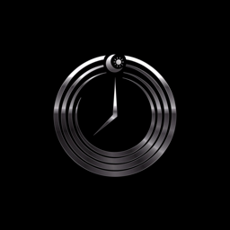
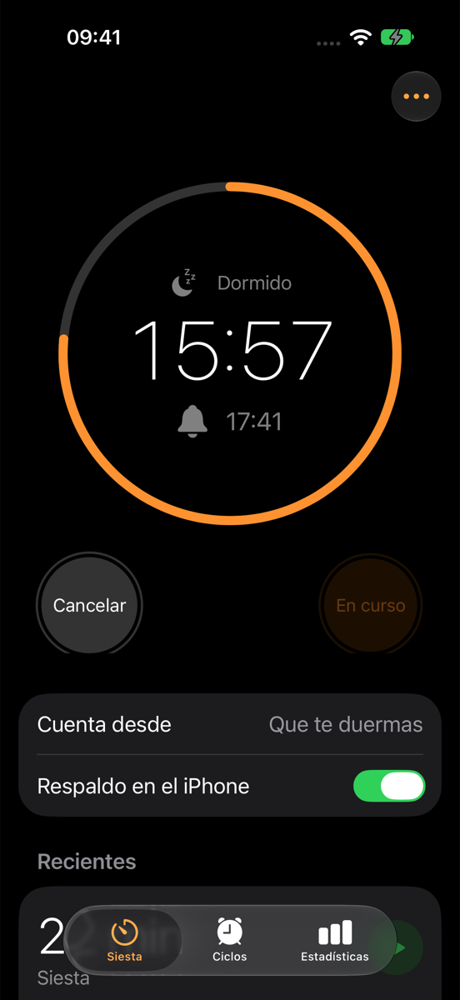
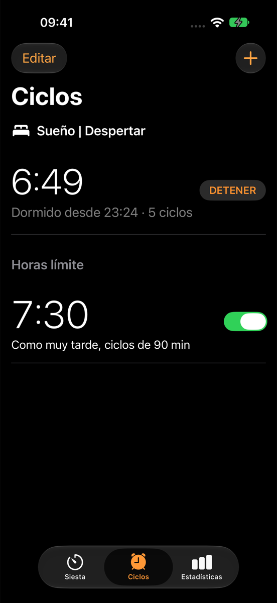
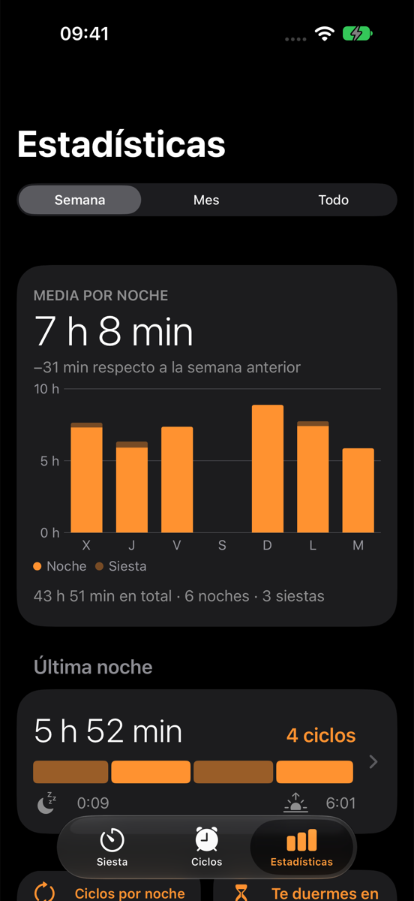
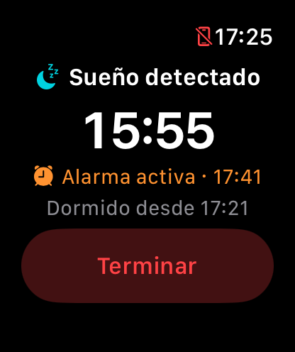

<p align="center">
  
</p>

<h1 align="center">Somni</h1>

<p align="center">
  <strong>Alarmas que entienden tu sueño.</strong><br>
  Despertador inteligente para iPhone y Apple Watch que empieza a contar cuando te duermes de verdad.
</p>

<p align="center">
  
  
  
  
  
</p>

<p align="center">
  
  &nbsp;
  
  &nbsp;
  
</p>

---

## El problema

Pones una alarma de 20 minutos para echarte una siesta, tardas 12 en dormirte y te despierta a los 8 minutos de haberte dormido. Por la noche pasa algo parecido: la alarma suena a una hora fija, a menudo en mitad de un ciclo de sueño profundo, y te levantas aturdido.

Las apps de sueño habituales no lo resuelven porque leen los datos de Salud, que el Apple Watch escribe por lotes con **entre 5 y 15 minutos de retraso**.

## Qué hace Somni

Somni usa el Apple Watch para saber **en qué momento exacto te has dormido** y programa la alarma a partir de ese instante.

### Modo 1 · Siesta

Eliges una duración (por ejemplo, 20 minutos) y pulsas Iniciar. El temporizador **no empieza al pulsar el botón, sino cuando te duermes**. El tiempo que pasas dando vueltas no cuenta.

### Modo 2 · Ciclos

Eliges la hora límite a la que tienes que estar despierto (por ejemplo, 7:30). Somni calcula tus ciclos de sueño de unos 90 minutos desde el momento en que te dormiste y te despierta **al final del último ciclo completo** antes de esa hora. Si en los 10 minutos previos detecta sueño ligero, te despierta un poco antes, justo cuando es más fácil levantarse.

> Te dormiste a las 23:24 y tu límite son las 7:30 → Somni suena a las 6:49, tras 5 ciclos completos.

### Estadísticas

Con cada sesión que terminas, el iPhone guarda un resumen y te muestra, por semana, mes o desde siempre:

- cuánto duermes por noche y en las siestas, y cómo cambia respecto al periodo anterior;
- los ciclos que completas cada noche, con una línea de tiempo de la última;
- cuánto tardas en dormirte y a qué horas te acuestas y te levantas;
- cuántas veces te despertó en sueño ligero, tu pulso al acostarte y tu racha de días.

### Apple Watch



El reloj hace el trabajo de verdad: mide, detecta el sueño y te despierta con vibración y sonido. Puedes iniciar y detener la sesión desde el reloj o desde el iPhone, y ambos se mantienen sincronizados.

El iPhone, con un diseño inspirado en la app Reloj de Apple, sirve para configurar, ver la sesión en directo, consultar las estadísticas y, opcionalmente, programar una **alarma de respaldo** por si el reloj no consigue despertarte.

<br clear="right">

## Cómo detecta el sueño sin retraso

En lugar de esperar a Salud, Somni lee los sensores del reloj en directo:

1. **Movimiento:** el acelerómetro se lee 25 veces por segundo y se resume en bloques de 10 segundos para detectar cuándo la muñeca se queda quieta de forma estable.
2. **Pulso:** la app abre una sesión de entrenamiento ligera ("Mente y cuerpo") para que el reloj mida el pulso cada pocos segundos y no cada varios minutos. Al dormirte, el pulso baja respecto al que tenías al acostarte. Esta sesión se descarta al terminar y no aparece en Fitness.
3. **Marcado retroactivo:** un búfer guarda en memoria los últimos 5 minutos de datos. Cuando la quietud y la bajada de pulso se mantienen durante unos minutos, Somni confirma que te has dormido y fecha el inicio del sueño **al principio de ese periodo estable**, no al momento de la confirmación. Así el retraso de la detección no se traslada a la alarma.

Si en 45 minutos no detecta que te hayas dormido, una alarma de seguridad garantiza que la sesión no se quede sin sonar.

## Privacidad

- **Sin servidores, sin cuentas, sin analítica, sin publicidad.**
- El pulso y el movimiento se procesan en la memoria del reloj y no se guardan.
- El historial y las estadísticas viven solo en tu iPhone. Los datos solo viajan entre tu iPhone y tu Apple Watch.
- Los periodos de sueño se guardan en la app Salud, bajo tu control.

Más detalle en la [política de privacidad](docs/privacidad/index.html).

> [!NOTE]
> Somni no es un producto sanitario. Sus estimaciones del sueño y de los ciclos no sirven para diagnosticar ni tratar ninguna enfermedad.

## Arquitectura

El proyecto se divide en un paquete Swift compartido, que contiene toda la lógica y no depende de sensores ni de la interfaz, y dos apps que lo usan.

```
Somni/
├── Packages/SomniKit/       Paquete compartido (Swift Package Manager)
│   ├── SomniKit/            Lógica pura, solo Foundation
│   │   ├── Models/          Modos, ciclos, configuración, épocas de sensores
│   │   ├── Engine/          Búfer circular y máquina de estados del sueño
│   │   ├── Alarm/           Cálculo de la hora de la alarma
│   │   ├── Stats/           Estadísticas de sueño
│   │   └── Sync/            Modelos y puente WatchConnectivity
│   └── SomniDesign/         Animaciones y estilo compartido (SwiftUI)
├── Apps/SomniWatch/         App del Apple Watch: sensores, detección y alarma
├── Apps/SomniPhone/         App del iPhone: configuración, estadísticas y alarma de respaldo
├── Marketing/               Vídeo de presentación y su renderizador
├── docs/                    Política de privacidad e imágenes
└── project.yml              Definición del proyecto de Xcode (XcodeGen)
```

| Pieza | Tecnología |
|---|---|
| Interfaz | SwiftUI, Swift Charts, patrón MVVM |
| Concurrencia | Swift 6 con concurrencia estricta, `async/await` y Combine |
| Sensores | Core Motion y HealthKit (`HKWorkoutSession`) |
| Ejecución en segundo plano | `HKWorkoutSession` y `WKExtendedRuntimeSession` de tipo *smart alarm* |
| Sincronización | WatchConnectivity |
| Alarma de respaldo | AlarmKit |

El diseño técnico completo (ciclo de vida en segundo plano, máquina de estados, umbrales y sincronización) está en [ARCHITECTURE.md](ARCHITECTURE.md).

## Cómo ejecutarla

**Requisitos:** un Mac con Xcode 26 o posterior. Para usarla de verdad, un iPhone con iOS 26 y un Apple Watch con watchOS 26.

1. Abre `Somni.xcodeproj`.
2. Elige el esquema **SomniPhone** o **SomniWatch** y un simulador.
3. Pulsa **▶**.

En el simulador del reloj, los sensores se simulan: un minuto de movimiento y después quietud con bajada del pulso. Aparece además un botón **Prueba (5 min)** para ver una siesta completa en poco tiempo.

Para instalarla en tus dispositivos, en **Signing & Capabilities** elige tu equipo en los dos targets. Con una cuenta gratuita de Apple la instalación dura 7 días.

### Datos de demostración

Las compilaciones de depuración aceptan argumentos de arranque (**Product → Scheme → Edit Scheme → Run → Arguments**) para enseñar la app sin dormir:

| Argumento | Qué muestra |
|---|---|
| `-SomniDemo nap` | Una siesta completa en segundos (iPhone y reloj) |
| `-SomniDemo cycles` | Una noche en modo Ciclos (iPhone) |
| `-SomniDemo stats` | Cinco semanas de datos de ejemplo en Estadísticas (iPhone) |
| `-SomniStatsPeriod month` o `all` | Abre Estadísticas en Mes o Todo |

Los datos de demostración se quedan en memoria y no sustituyen a los tuyos.

### Tests

La lógica del motor, de las alarmas y de las estadísticas se prueba en el Mac, sin simuladores:

```bash
cd Packages/SomniKit
swift test
```

### Regenerar el proyecto

`Somni.xcodeproj` se genera a partir de `project.yml`. Si añades archivos o cambias la configuración:

```bash
brew install xcodegen
xcodegen
```

## Estado

Proyecto personal en desarrollo. Las dos apps compilan y funcionan en el simulador. Falta probar la detección en un Apple Watch real durante varias noches para ajustar los umbrales antes de publicarla en la App Store.
